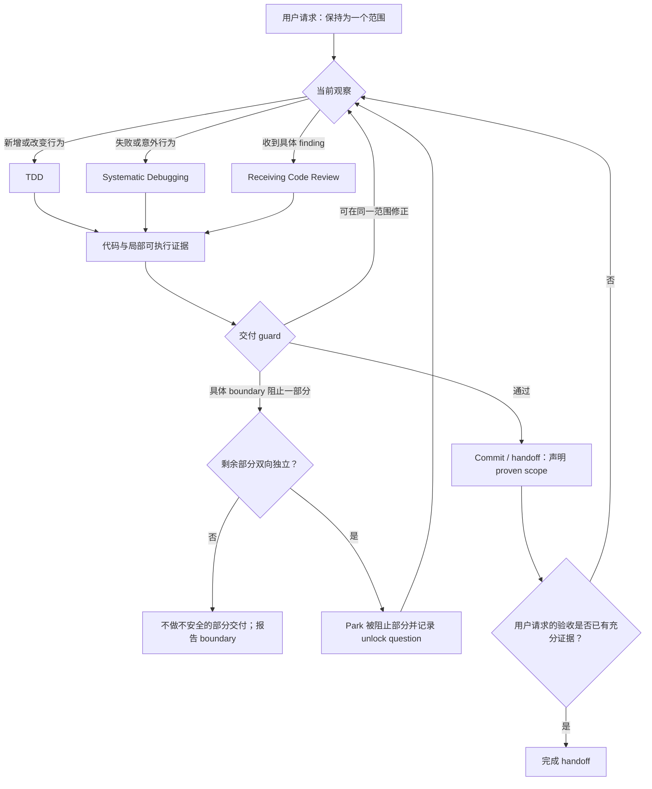
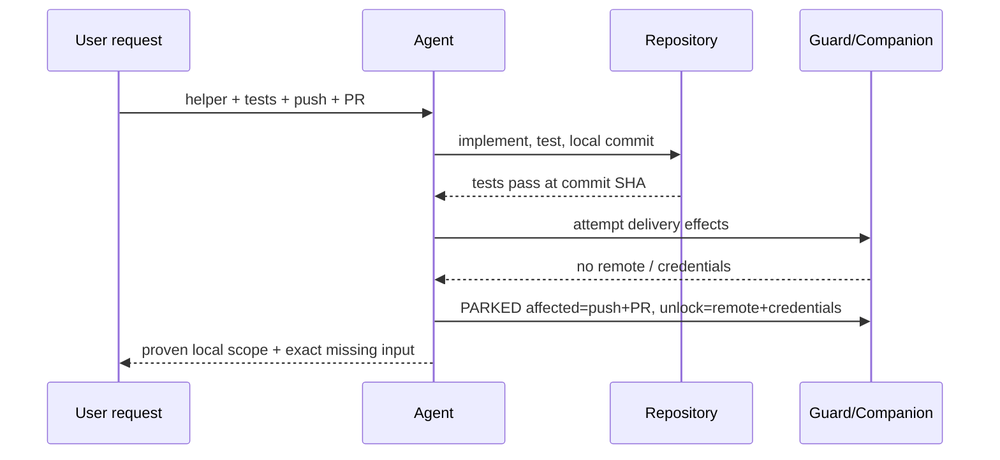

# Ockle Skill Pack 设计草案

> 状态：待对抗性评审。本文描述预期产品形状，不是实现计划，也不授权创建未列出的流程对象。
>
> 实测依据见 [FINDINGS.md](./FINDINGS.md)。本文只承载设计，不复制实验结论。

## 1. 设计目标

Ockle 保留稳定的软件工程方法，删除由模型手工维护的流程架构。

核心约束：

1. 用户请求默认保持为一个范围，不预先拆成交付目标。
2. 可观察性约束交付声明如何被证明，不创造工作单元。
3. 测试、文件、commit、worker task、调试步骤和 RED/GREEN 都不是外环交付单元。
4. 方法技能不维护计划、进度、状态机或耐久工作对象。
5. 编排机制由宿主 harness 提供；skill 只保留 harness 无法替代的软件工程判断。
6. 普通任务没有观察到边界时，外环必须接近零额外成本。
7. 规范性 gate 必须有行为 check 和失败出口；未验证的启发式不进入 skill 文本。
8. 上下文恢复使用有界投影，不返回完整历史。

本文使用“内环”和“外环”作为设计者的分析语言。Skill 文本不要求模型声明自己处于哪个环，也不引入环之间的状态转换。

> **当前实现范围：** v0 只包含三个内环 skill。下文的 SDD、无人值守交付和 companion 均为候选设计，不属于当前发布内容。

## 2. 仓库与发布结构

```text
Ockle/
├── README.md
├── DESIGN.md
├── FINDINGS.md
├── LICENSE
├── upstream-manifest.json
│
├── skills/                              # 发布的 Skill Pack
│   ├── test-driven-development/
│   │   ├── SKILL.md
│   │   ├── writing-good-tests.md
│   │   └── editing-tests.md
│   ├── systematic-debugging/
│   │   ├── SKILL.md
│   │   ├── root-cause-tracing.md
│   │   ├── defense-in-depth.md
│   │   ├── condition-based-waiting.md
│   │   ├── condition-based-waiting-example.ts
│   │   └── find-polluter.sh
│   ├── receiving-code-review/
│   │   └── SKILL.md
│   ├── subagent-driven-development/
│   │   └── SKILL.md
│   └── unattended-delivery/
│       └── SKILL.md
│
├── companion/                           # 可选 enforcement，不作为 skill 自动加载
│   └── README.md                        # guard、事件日志、恢复投影的宿主接口
│
├── tests/                               # 静态结构与机械 guard 测试
│   ├── architecture.test.mjs
│   └── guards.test.mjs
│
├── evals/                               # 真实模型行为评测
│   ├── README.md
│   ├── tasks/
│   └── results/
│
└── scripts/
    └── test.mjs
```

### 2.1 发布边界

发布给 Agent Skills 宿主的运行时内容只有 `skills/` 及必要元数据。`tests/`、`evals/` 和开发脚本不进入模型上下文。

`companion/` 定义一个可选宿主能力接口：

- 没有 companion 时，Ockle 仍是可用的 host-neutral 方法 Skill Pack。
- 没有 companion 时，Ockle 不声称能够机械阻止契约削弱或保证跨压缩恢复。
- 安装 companion 后，guard、证据采集和恢复投影由工具执行，skill 不重复实现这些机制。

初始版本不设置 `using-ockle` router。每个 skill 依靠自身 trigger 按需加载；普通任务不先支付一轮风险分类成本。

### 2.2 测试边界

静态契约测试只检查结构与耦合，例如：

- 三个核心方法 skill 中扩展专有词汇为零。
- skill 不引用 companion 的内部文件格式或命令实现。
- 发布包不包含测试、评测结果和开发状态。
- guard 对输入 diff 的行为与退出码符合契约。

测试不得要求 `SKILL.md` 包含某段固定措辞。Skill 有效性必须由真实模型行为评测证明。

## 3. 分层职责

| 层 | 责任 | 明确不拥有 |
| --- | --- | --- |
| 仓库 ground truth | tests、schemas、API contracts、兼容性工具、仓库约束 | Agent 流程状态 |
| 方法内核 | TDD、根因调试、审查 finding 的验证与修正 | 规划、派发、持久化、任务完成判定 |
| 能力扩展 | 是否值得并行、完整集合的集成纪律、无人值守边界判断 | Harness 调用教程、canonical work units |
| Companion | guard、事实采集、append-only 事件、恢复投影 | 产品决策、软件工程语义判断 |
| Harness | dispatch、并发、worktree、reviewer、预算、恢复、制品收集 | 根因、兼容性和验收语义 |

## 4. Skill 清单与方法

以下各节的 **Trigger / 方法 / 术语 / 输出** 描述预计进入对应 `SKILL.md` 的内容边界。“设计边界”只用于本文审查职责，不复制进核心方法 skill；因此核心 skill 不需要通过提及外环名词来声明自己“不做外环”。

### 4.1 `test-driven-development`

#### Trigger

新增或改变可执行行为，或者需要修复已有行为回归。

#### 方法

- 按功能在稳定消费边界上的可观察行为组织检查，不按修改的函数清单配测试。复用已有检查；需要时补充能区分正确与错误的例子。
- 行为明确或缺陷可复现时，用 test-first 取得实现前后的反馈。接口尚未成形时，允许小原型、调用实验和实现帮助发展认识；特征刻画和重构检查可以从通过状态开始。用户或仓库明确要求的 test-first 顺序仍遵守。
- 核对失败来自实现、预期、测试装置还是环境。依据当前有效契约修订相应部分，不因测试已经存在就把其预期视为不可改变，也不为迎合实现削弱有效要求。
- 按变更及交付要求选择验证范围。测试累积时，随相关工作维护分组、压缩重复覆盖和配置选择／skip；不把全量运行或套件审计设为每轮固定阶段。未运行、skip 和未解决失败不冒充通过。

测试的有效性、真实边界、替身与套件维护见 [writing-good-tests.md](skills/test-driven-development/writing-good-tests.md)；已有测试的修改情境见 [editing-tests.md](skills/test-driven-development/editing-tests.md)。

#### 术语

- `desired behavior`：用户或仓库要求的行为。
- `oracle`：能区分正确与错误的可执行检查。
- `RED`：采用 test-first 时，oracle 因目标行为缺失而失败。
- `GREEN`：同一 oracle 在实现后通过。
- `refactor`：不改变约定行为的结构改进。

#### 输出

必要的 `patch`，以及已执行验证的结果、范围与限制。采用 test-first 时保留相应的失败／通过依据，不要求为所有工作重新制造 RED/GREEN。

**设计边界（不写入该 `SKILL.md`）**：该方法不拥有交付拆分、持久进度或跨会话状态。

### 4.2 `systematic-debugging`

#### Trigger

调查 bug、失败检查或运行、构建、性能方面的意外行为；不只限于根因未知的情况。

#### 方法

- 从实际失败、发生条件和期望结果出发，保留原始报错或测量。核对期望是否仍有效，以及观察是否真正触及待检查的行为；准备阶段失败不等于产品行为失败。
- 用当前不确定性选择比较、追踪或观察。已有用例和相关代码足以解释局部失败时，可直接修正复验；否则在能区分解释的位置取得必要信息，不以完成固定阶段或全链插桩为前提。
- 可逆改动可以作为实验，但需知道结果支持或削弱哪个解释，避免无关变化混入对照。反直觉结果先检查装置、时钟和计量是否有效；尝试次数本身不证明架构有误。
- 在承担有效要求的组件修复。触发位置、报错位置和修复职责可能不同；装置有误时修装置后执行原行为，预期有误时先确立依据，再改断言。保留仍有效的契约保护。
- 在可比条件下复验原问题，检查受影响消费者及交付要求。复用已有回归；有持续保护价值时在稳定消费边界补充。临时探针完成用途后清理，有持续诊断需要的另行支持；间歇故障说明复验条件和范围，不以一次通过证明根因消失。
- 经授权可以先回滚或限制影响，核实实际恢复了什么。诊断仍开放时保留未知、已排除解释及下一项有用观察，缓解不冒充已验证修复。

按具体问题使用 [root-cause-tracing.md](skills/systematic-debugging/root-cause-tracing.md)、[defense-in-depth.md](skills/systematic-debugging/defense-in-depth.md) 和 [condition-based-waiting.md](skills/systematic-debugging/condition-based-waiting.md)；测试设计与修订按需接入 `test-driven-development`。

#### 术语

- `symptom`：实际观察到的失败或意外结果，尚不决定它来自产品、装置、预期还是环境。
- `reproduction`：在明确条件下触发或观察 symptom 的方法；能否稳定重复也是调查信息。
- `observation`：工具实际返回的事实及其条件。
- `hypothesis`：可以用结果支持或削弱的原因解释。
- `root cause`：证据支持的故障机制；其触发位置不自动成为修复职责位置。
- `regression oracle`：保护持续有效行为的检查，不要求每次调查另增一个。
- `containment`：恢复服务或限制影响的处置，不等于确认了原因。

这里的 `hypothesis` 是调试方法术语，不是外环的“假设并标记”分类。

#### 输出

证据支持的原因解释、必要的 `patch`，以及实际复验的结果、条件和范围。未完成诊断时明确未知和缓解效果，不强行给出根因或把无关通过结果当作修复证据。

### 4.3 `receiving-code-review`

#### Trigger

收到人类或工具对当前改动的 review 反馈，需要决定如何处置。

#### 方法

- 在被审版本上核对描述的现象或代码路径。差异和调用者已经足以判断时不再重复实验；依赖运行结果时用针对性用例，无法核实时说明缺少什么。
- 判断现象是否违反有效要求。用户请求、公开接口和功能依赖的安全性质可以建立期望；既有或新增断言可能表达契约，也可能记录偶然实现。reviewer 一致但共享同一个未经核实的前提，不构成独立证据。
- 单独评价建议的修法，在承担要求的位置修正。下游表示需求先由消费者适配；共享接口本身不足时再判断其修改。相关路径共享错误假设时继续检查，不因代码相似自动搜索并修复所有邻近位置。
- 保留声明的运行时、平台和公共 API 支持，除非 owner 已授权变化。本机测试工具和仓内未找到调用，都不自动授权提高最低版本、删除兼容回归或撤掉公开接口。
- 对受不确定信息影响的项目等待决定，继续独立且已理解的工作。分别理解的修复可以共享验证运行，结果仍应揭示检查了什么；按证据修复、反驳或说明限制，新证据推翻旧回应时修正判断。

#### 术语

- `finding`：关于改动的缺陷主张，不预设其已成立或其修法已正确。
- `validity`：描述的现象是否存在，以及它是否违反当前有效要求。
- `owning layer`：应当承担被违反要求的实现位置。
- `sibling defect`：共享错误假设的其他缺陷实例，是否检查取决于实际关联。
- `re-verification`：对实际修改所影响行为的复验及范围说明。

#### 输出

`finding disposition`、必要的 `patch` 和实际 `re-verification` 证据；把已确认、不同意和暂不能核实的意见说明清楚。

**设计边界（不写入该 `SKILL.md`）**：review round、review budget 和 reviewer 生命周期属于 harness，而非该方法。

### 4.4 `subagent-driven-development`

#### Trigger

存在两个以上候选工作面，并且并行可能显著缩短关键路径。宿主已具备 worker、隔离和结果收集能力。

#### 方法只保留两个判断

1. **是否并行**：所有权是否真正不相交；接口是否已冻结；节省的关键路径是否大于协调成本。
2. **如何集成**：只接纳完整集合，不做部分集成；先验证每份结果的所有权，再在 canonical workspace 集成并验证整体。

#### 术语

- `ownership`：一个 writer 可修改的代码和可变资源边界。
- `frozen interface`：并行期间不允许单方改变的共享契约。
- `critical-path saving`：并行相对串行实际节省的等待时间。
- `complete set`：当前并行派发预期返回的全部结果。
- `integration`：将完整集合纳入 canonical workspace。
- `recovery`：已提交结果按反序 revert；未提交结果只反向应用其 patch。

#### 输出

临时 worker 结果、patch 和集成证据。扩展不创建共享 manifest、Package、Milestone 或状态机。

Dispatch、concurrency、worktree、reviewer、status、resume、budget 和 artifact collection 全部由 harness 提供，不在 skill 中重述。

### 4.5 `unattended-delivery`

#### Trigger

用户明确要求长时无人值守、跨压缩继续工作，或者当前会话确定在用户无法及时回答时仍需产生可审计进展。默认不加载。

#### 方法

1. 把用户请求保持为一个 `request scope`，不预先拆分。
2. 正常使用方法内核推进请求。
3. 只有观察到具体 boundary 后，才考虑剔除被它直接阻止的部分。
4. 仅当剩余行为在“双向独立”意义上成立时继续：被剔除部分永远不做，剩余仍正确有用；以后补上被剔除部分，不破坏已交付行为。
5. handoff 只声明有新鲜证据支持的 `proven scope`；park 必须点名具体 `unlock question`。

#### 术语

- `request scope`：用户请求本身，不是模型创建的对象或列表。
- `boundary`：已经观察到的 guard failure、缺失输入、未授权 effect 或仓库契约。
- `proven scope`：handoff 时由实际证据支持的请求范围。
- `park`：只停止被具体 boundary 阻止的部分。
- `unlock question`：继续该部分所缺的一个具体输入。
- `effect`：push、PR、部署、迁移执行、删除或其他外部/不可逆动作。

#### 输出

默认只产生代码、测试和正常 Git 记录。安装 companion 时，可额外产生一条由工具采集的 `PROVED` 或 `PARKED` 事件。

该 skill 不包含：目标列表、决策三分法、assumption register、阶段、路线、风险等级或“永不完成”的终态规则。

## 5. 术语边界

### 5.1 内外环接口词汇

三个核心方法 skill 之间只交换普通工程输出：

- `patch`
- `evidence`

以下术语只允许出现在 `unattended-delivery`、外部 handoff 或 companion 投影中，不进入三个核心方法 skill：

- `request scope`
- `boundary`
- `proven scope`
- `park`
- `unlock question`

RED、GREEN、reproduction、hypothesis、finding、ownership 等方法术语只在对应 skill 内使用。

### 5.2 不作为 Ockle 工作对象的词

以下词可以出现在普通英语或宿主 API 中，但 Ockle 不赋予其持久流程语义：

- target
- task unit
- Package
- Milestone
- wave
- frontier
- route/profile
- current phase
- workflow transition
- planned delivery

特别地，harness 可以有一个 `task` 参数；这不意味着 Ockle 拥有名为 Task 的方法论对象。

## 6. Companion 接口边界

Companion 是可选 enforcement，不是第六个 skill。

### 6.1 Guard

候选 guard 包括：

- 既有 assertion、snapshot、schema 或契约 oracle 被移除或削弱。
- 已声明公共接口发生 removal/rename，但没有兼容路径。
- live/destructive/irreversible effect 缺少明确授权。
- handoff 声称的证明命令未执行、失败或与当前代码身份不匹配。

Guard 先产生事实，再由方法技能判断如何修复。合法的契约变更可以修改既有 oracle，但在无人值守模式下必须有明确授权和替代 oracle；不能由 Agent 静默放宽测试。

每个 guard 必须定义：输入、可检查 verdict、失败出口、误报处理和上下文返回预算。

### 6.2 Append-only 事件

候选事件形状：

```text
REQUEST      request=<verbatim-or-reference> identity=<hash>
PROVED       commit=<sha> command=<exact-command> result=<result>
PARKED       affected=<exact-request-part> unlock=<specific-missing-input>
INVALIDATED  prior=<event-id> reason=<fresh-failed-check>
```

Git identity、命令、结果和时间由工具采集。模型只能填写无法机械获得的 `affected`、`unlock` 或语义性 `reason`。

事件记录已经发生的事实，不记录计划、未来工作、当前阶段或 canonical state。

### 6.3 长上下文恢复投影

自动压缩后，模型不应依赖回读完整 session。Companion 可以从用户请求、Git 和 append-only 事件生成一个临时、有界投影：

```text
request:     原始用户请求或其不可变引用
workspace:   HEAD / tree / dirty identity
proved:      当前仍有效的证明摘要
open parks:  尚未被后续事件解除的 affected + unlock
```

投影具有以下约束：

- 它是按需生成的 view，不是新的耐久状态文件。
- 不含 future work、目标列表、阶段或完整事件历史。
- 每次返回有明确字节/token 上限；超过预算时返回引用，而不是截断事实。
- 任何 `proved` 条目在代码、命令或环境发生实质漂移后必须失效。

这套恢复投影仍是待行为评测的候选设计。Ockle 在验证前不声称能够在任意压缩次数后无损保持目标认识。

## 7. 宏观执行流程



该图表示判断关系，不表示持久状态机。节点不对应文件、对象或强制工具调用。

## 8. 预期执行例子

### 8.1 普通行为变更

请求：“CLI 支持 `.myapprc`，显式参数优先。”

- 请求始终保持为一个范围。
- TDD 在 CLI 消费边界建立配置读取与优先级行为。
- parser、merge logic、错误处理和多条测试都是内部实现，不形成 D1/D2/D3。
- guard 通过后提交，并报告覆盖该行为的命令和结果。
- 没有计划文件、外环日志或额外管理调用。

预期加载：`test-driven-development`。

### 8.2 未知根因的 flaky test

请求：“修复 CI 中偶发失败的 queue test。”

- `systematic-debugging` 从原始失败和运行条件出发，比较排队状态与执行顺序，用可重复的交错或针对性观察检验 slot collision 的解释。
- 证据支持原因后修复相应职责，按需使用 TDD 复用或补充稳定消费边界上的回归检查。
- reproduction、实验和 regression test 都属于同一个请求范围。
- handoff 绑定复现频率、修复后重复运行结果和当前 commit。

预期加载：`systematic-debugging`，修复时按需加载 `test-driven-development`。

### 8.3 无 remote 的无人值守任务

请求：“增加 `titleCase` helper，然后 push 并开 PR。”

- `unattended-delivery` 不把 helper、tests、push、PR 预先命名为四个目标。
- helper 与 tests 正常完成并形成 local commit。
- push 时观察到缺少 remote，这是一个具体 boundary。
- 外部 effect `push + PR` 可以从本地代码交付中独立剔除；以后补做不会破坏 helper。
- handoff 声明本地 proven scope，并 park `push + PR`，unlock question 为目标 remote URL/凭据。



预期加载：`test-driven-development` + `unattended-delivery`。

### 8.4 值得并行的实现

请求包含两个所有权不相交、共享接口已经冻结的实现面。

- `subagent-driven-development` 只判断是否值得并行和如何完整集成。
- Harness 创建隔离、派发 worker、收集 patch 和 reviewer 结果。
- 任一预期结果失败时不做部分集成。
- 完整集合进入 canonical workspace 后运行整体行为检查。
- 并行 worker 的任务或 worktree 不成为 Ockle 的持久工作对象。

预期加载：一个相关方法 skill + `subagent-driven-development`；无人值守时才额外加载 `unattended-delivery`。

## 9. 上下文与流程成本预算

### 9.1 正常路径

没有观察到 boundary 的普通任务：

- 不加载 `unattended-delivery`。
- 不增加独立的 companion 管理调用；已安装的 repository guard 可以复用现有 test、pre-commit 或 CI 入口。
- 不产生 Ockle 管理制品。
- 不增加“定义目标”或“选择路线”的模型回合。

### 9.2 扩展路径

- SDD 的额外判断次数为一次并行准入、一次完整集合准入和一次集成后验证。
- 无人值守模式每个实际 boundary 最多追加一个 `PARKED` 事件；普通内部步骤不写事件。
- 恢复投影每次只返回当前 request、workspace identity、有效证明和 open parks，禁止全量历史返回。

### 9.3 复杂度目标

对一个不触发扩展的请求，Ockle 的流程复杂度应与裸方法执行同阶。扩展只在观察到对应事实后增加常数级检查，不随预想任务数增长。

任何实现若要求预先枚举 `n` 个目标、每次 mutation 返回全部历史，或让每个内部步骤写耐久记录，均违反本设计。

## 10. 行为评测门槛

至少覆盖以下对照：

1. **防过度拆分**：实现细节很多但只有一个用户行为；Ockle 不应生成额外目标或管理制品。
2. **Guard 干预**：`bare / prose rule / mechanical guard` 三臂比较破坏性改动是否被提交，以及失败后的恢复质量。
3. **部分交付边界**：同时包含可独立 effect 和不可拆事务不变量，验证模型只剔除真正独立的部分。
4. **长上下文压缩**：多轮压缩后不给完整 session，只给候选恢复投影；测量目标识别、已证明范围、open parks 和重复工作。
5. **扩展成本**：记录加载词数、工具调用、返回字节、耐久文件数和总上下文成本。

完成门槛是行为改善且成本在预算内，不是静态文档自洽。

## 11. 尚未批准为实现事实的部分

以下内容仍需评审和行为验证：

- Companion 与 Skill Pack 是否同仓发布，还是独立包。
- 通用 compatibility guard 如何读取仓库自己的 ground truth。
- Append-only 事件的最小字段和存储位置。
- 自动压缩后 request 的不可变引用由宿主还是 companion 保存。
- `PROVED` 事件不含模型编写的 scope 摘要；恢复投影如何仅凭 request、代码身份和实际 evidence 重建语义进展。
- 恢复投影的字节预算与失效算法。
- 五个 skill 的最终词数预算。

这些问题未闭合前，不创建 schema、CLI、状态文件或兼容别名。
