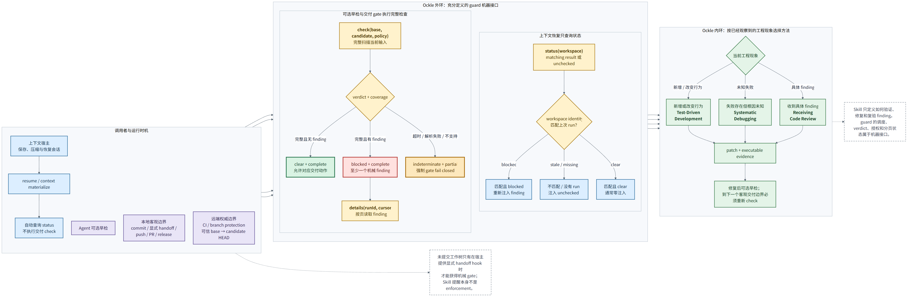
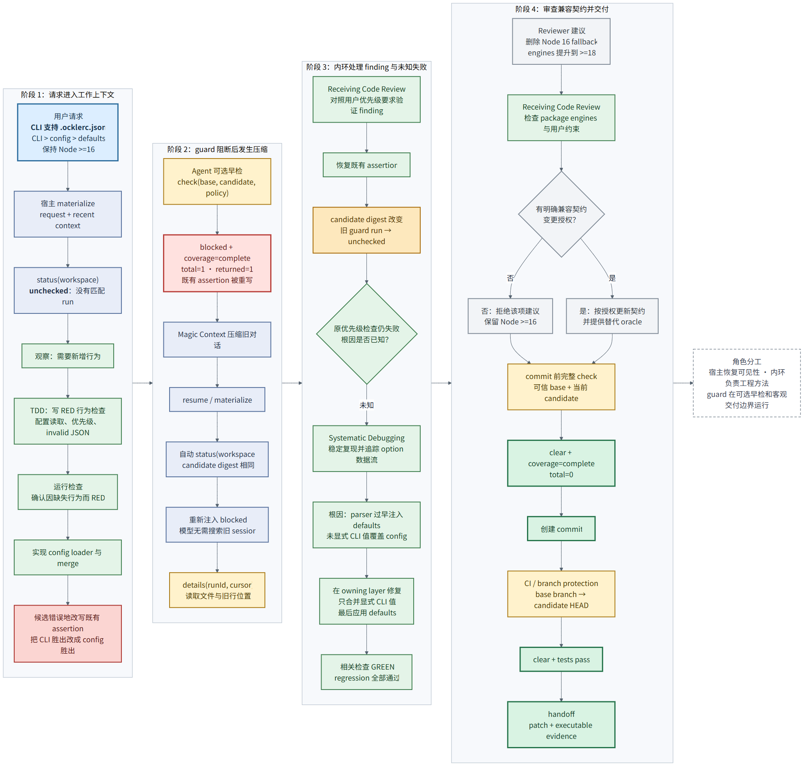

# Ockle 内外环流程图

这些图只表达截至当前讨论已经澄清的结构，不采用早期设计中的
`unattended-delivery`、append-only workflow events 或 Ockle 自己的上下文压缩层。

## 组织结构



Mermaid 源文件：[inner-outer-runtime.mmd](inner-outer-runtime.mmd)

## 中等复杂度 SWE 示例

示例请求：为 CLI 增加 `.ocklerc.json` 配置支持，保持
`CLI > config > defaults`，并维持 Node `>=16` 兼容契约。



Mermaid 源文件：[medium-swe-example.mmd](medium-swe-example.mmd)

## 渲染

使用 Mermaid CLI 11.16.0：

```bash
mmdc -i docs/diagrams/inner-outer-runtime.mmd \
  -o docs/diagrams/inner-outer-runtime.png \
  -b white -w 3000 -s 1.5

mmdc -i docs/diagrams/medium-swe-example.mmd \
  -o docs/diagrams/medium-swe-example.png \
  -b white -w 3600 -s 1.5
```

本机渲染时使用系统 Chrome，并以 Microsoft YaHei 作为中文字体。
